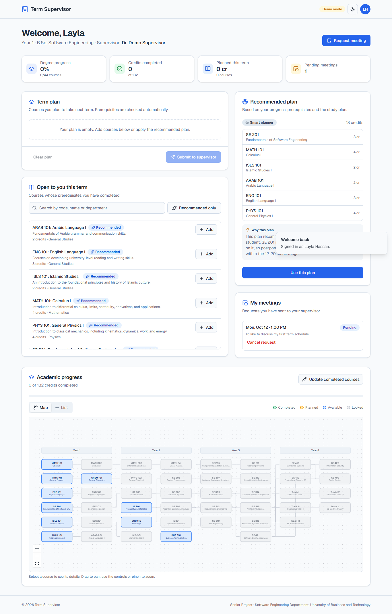
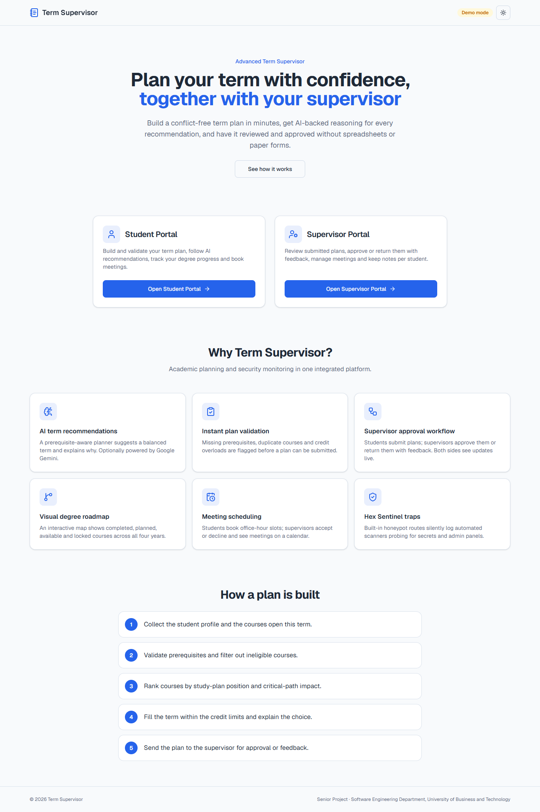
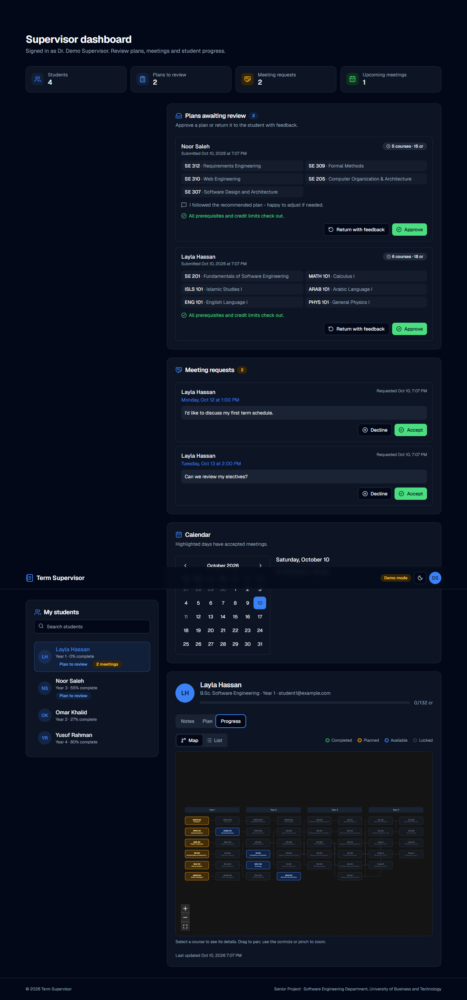
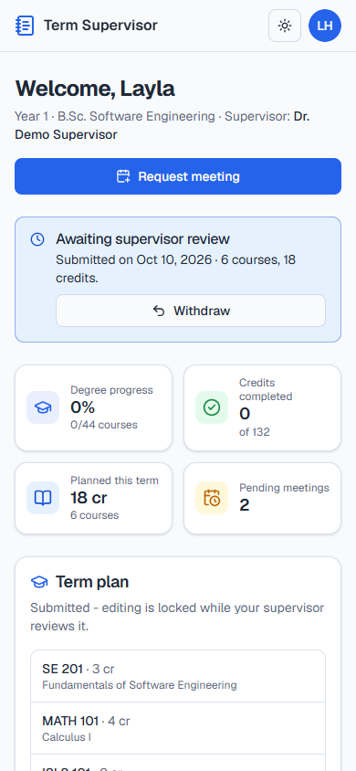
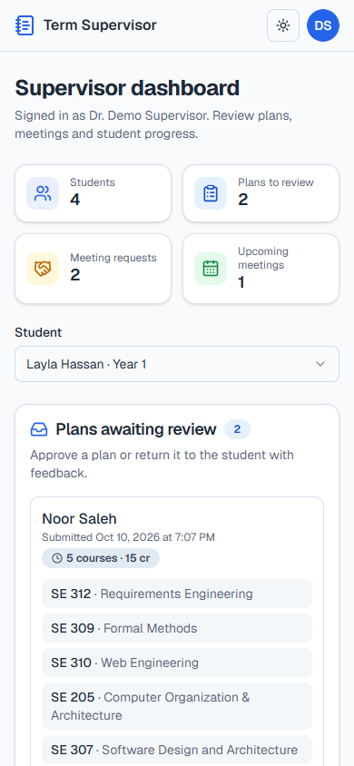
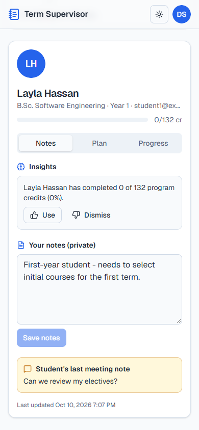
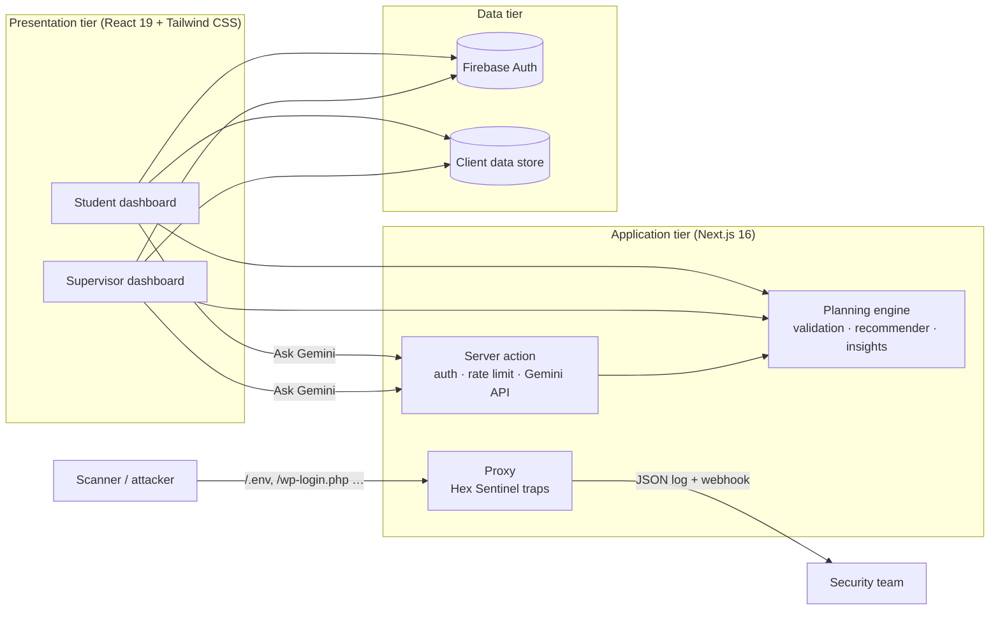
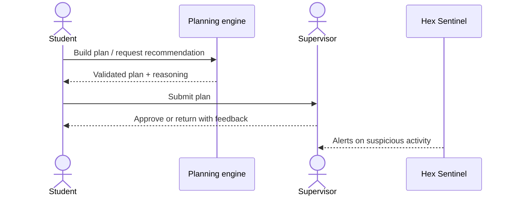

# Advanced Term Supervisor

**AI-assisted academic term planning with supervisor approval and built-in honeypot security.**

Senior Project · Software Engineering Department, College of Engineering, University of Business and Technology (UBT), Jeddah, Saudi Arabia

[](.github/workflows/ci.yml)


-0_vulnerabilities-brightgreen)



---

## Contents

- [Abstract](#abstract)
- [Features](#features)
- [Screenshots](#screenshots)
- [Quick start](#quick-start)
- [Configuration](#configuration)
- [How it works](#how-it-works)
- [Project structure](#project-structure)
- [Testing](#testing)
- [Security](#security)
- [Deployment](#deployment)
- [Project report](#project-report)
- [Contributing](#contributing)
- [Team](#team)

---

## Abstract

The **Advanced Academic Term Supervisor** transforms how universities manage term planning while strengthening their cybersecurity posture. Higher-education institutions still face fragmented scheduling, class conflicts, delayed graduation and a growing exposure to cyber threats. Many, including UBT, rely on manual coordination (spreadsheets and handwritten forms), which slows both administration and student progression.

At its core, the system is a centralized academic hub. Data-driven algorithms and AI-powered suggestions streamline term planning, detect scheduling problems in real time and recommend an optimized academic path for each student, with the reasoning behind every suggested schedule and course load, so advisors and students can make informed decisions. A built-in honeypot module, **Hex Sentinel**, silently monitors system interactions: it exposes decoy endpoints that legitimate users never touch and logs anyone who probes them.

The platform follows a three-tier architecture (presentation, application and data) for modularity, scalability and maintainability, and its interface serves both students and supervisors on desktop and mobile.

---

## Features

### For students
- **Term plan builder.** Add courses that are open to you, with live validation for missing prerequisites, duplicates, already-completed courses and the 12–20 credit limit. Plans with blocking errors cannot be submitted.
- **Recommended plan with reasoning.** A rule-based planner ranks eligible courses by study-plan position and critical-path impact (how many later courses depend on them), fills the term to about 18 credits and explains why. With a Gemini API key, **Ask Gemini** produces an AI recommendation that is re-validated against the same rules.
- **Submit for approval.** Send the plan to your supervisor with a note, see its status (pending, approved or returned with feedback), withdraw a pending plan, and mark an approved term as completed.
- **Degree roadmap.** An interactive 8-term map (or a mobile-friendly list) shows *completed*, *planned*, *available* and *locked* courses and their prerequisite links. Tap any course for details.
- **Meeting requests.** Book a 30-minute office-hour slot (Sunday–Thursday) and see whether it was accepted or declined.

### For supervisors
- **Inbox.** Plans awaiting review are re-checked against the student's current record. You can approve them or return them with required feedback.
- **Meeting management.** Accept or decline requests with an optional message. Accepted meetings appear on a calendar.
- **Per-student view.** Progress, current plan, recommended plan and the degree map for each student.
- **Notes and insights.** Private notes that persist, plus automatic insights (overdue courses, bottleneck courses, overloaded plans, graduation readiness, summer-training eligibility). Use an insight to copy it into your notes, or dismiss it.

### Platform
- **Role-based access.** Dashboards are guarded by role, a student account cannot enter the supervisor portal, and supervisor access is limited to an email allowlist in Firebase mode.
- **Two auth modes.** Real **Firebase Authentication** when configured, or a zero-setup **demo mode** with seeded accounts so anyone can explore the project.
- **Hex Sentinel Lite.** Decoy routes (`/.env`, `/.git/config`, `/wp-login.php`, `/phpmyadmin`, …) return a plain 404 while logging the request as structured JSON, with optional webhook alerts.
- **Security headers.** `X-Frame-Options`, `X-Content-Type-Options`, `Referrer-Policy` and `Permissions-Policy` are set, and `X-Powered-By` is hidden.
- **Responsive and accessible.** Mobile-first layouts, light and dark themes, keyboard-accessible components and a skip-to-content link.

---

## Screenshots

| Landing page | Supervisor view (dark mode) |
| --- | --- |
|  |  |

| Student (mobile) | Supervisor (mobile) | Student notes and insights (mobile) |
| --- | --- | --- |
|  |  |  |

---

## Quick start

**Requirements:** Node.js **24 LTS** (22.13+ also works; see `.nvmrc`) and npm.

```bash
git clone <your-repo-url> term-supervisor
cd term-supervisor
npm install
npm run dev
```

Open <http://localhost:9002>. With no configuration the app runs in **demo mode**: data is stored in your browser and these accounts are available (password `demo1234`; the login pages also have one-click buttons):

| Role | Email | Notes |
| --- | --- | --- |
| Supervisor | `supervisor@example.com` | Sees all students, plans and meetings |
| Student, Year 1 | `student1@example.com` | Has a pending meeting request |
| Student, Year 2 | `student2@example.com` | Has an accepted meeting |
| Student, Year 3 | `student3@example.com` | Has a plan awaiting review |
| Student, Year 4 | `student4@example.com` | Final year |

> Tip: open a student and the supervisor in two tabs of the same browser. Submissions, approvals and meetings sync between them instantly. Use **Reset demo data** in the account menu to start over.

### Scripts

| Command | Description |
| --- | --- |
| `npm run dev` | Start the dev server on port 9002 |
| `npm run build` / `npm start` | Production build / serve |
| `npm run lint` | ESLint (Next.js core-web-vitals and TypeScript rules) |
| `npm run typecheck` | TypeScript type check |
| `npm test` | Unit tests (Vitest) |
| `npm run check` | Lint, typecheck and tests |
| `npm run audit` | Check production dependencies for known vulnerabilities |

---

## Configuration

Copy `.env.example` to `.env.local`. Every variable is optional.

| Variable | Purpose |
| --- | --- |
| `NEXT_PUBLIC_FIREBASE_*` | Firebase web app config. When set, Firebase Email/Password auth replaces demo mode. Enable *Email/Password* under Authentication → Sign-in method. |
| `NEXT_PUBLIC_SUPERVISOR_EMAILS` | Comma-separated emails allowed into the Supervisor Portal (Firebase mode). |
| `NEXT_PUBLIC_SUPERVISOR_NAME` | Supervisor name shown on student dashboards. |
| `GEMINI_API_KEY` | Enables **Ask Gemini** (server-side only, never sent to the browser). Get one at [Google AI Studio](https://aistudio.google.com/apikey). |
| `GEMINI_MODEL` | Gemini model ID (default `gemini-flash-latest`). |
| `HEX_SENTINEL_ENABLED` | Set to `false` to disable honeypot logging. |
| `HEX_SENTINEL_WEBHOOK_URL` | Optional webhook (Slack, Discord, Teams…) that receives a JSON alert for each trap hit. |

> **Never commit `.env.local`.** It is ignored by `.gitignore`. Only `NEXT_PUBLIC_*` values reach the browser, and Firebase web config is designed to be public: protect your project with Firebase security rules and authorized domains, not by hiding the config.

---

## How it works

### Architecture

The system follows the three-tier architecture described in the report, implemented as a full-stack Next.js application:



- **Planning engine** (`src/lib/planning.ts`): pure, unit-tested functions for prerequisite checks, plan validation, the recommender and supervisor insights. The same code runs in the browser and in the server action that validates AI output.
- **AI** (`src/ai`, `src/app/actions/recommend.ts`): a dependency-free Gemini API client asks the model to choose and explain a plan, using **only** courses whose prerequisites are met. The server action verifies the caller's Firebase ID token, rate-limits requests, sanitizes input and re-checks the answer (eligibility and credit limit), so the model can rank and explain but never bypass academic rules.
- **Auth** (`src/lib/auth`): a small backend interface with Firebase and demo implementations, plus role resolution and route guards.
- **Data store** (`src/lib/store.ts`): profiles, submissions and meetings behind one module with live cross-tab sync. It currently persists to the browser's `localStorage`. Swapping in Cloud Firestore only requires changing this module (see [Future work](#future-work)).
- **Hex Sentinel Lite** (`src/proxy.ts`, `src/lib/hex-sentinel.ts`): runs only for decoy paths, responds `404`, and emits records such as:
  ```json
  {"event":"hex-sentinel.trap","timestamp":"2026-10-10T16:05:39.253Z","ip":"203.0.113.7","method":"GET","path":"/.env","query":"","userAgent":"curl/8.4","referer":""}
  ```

### Recommendation algorithm

1. Collect the student profile (year, completed courses) and the program's study plan.
2. Validate prerequisites and keep only courses that are eligible this term.
3. Rank them: courses scheduled for earlier terms (overdue) first, then courses on the longest prerequisite chain, then courses that unlock the most later courses.
4. Fill the term up to the target load (18 credits by default) within the 12–20 credit limits.
5. Explain the choice (catch-up courses, critical-path course, load) and present it for supervisor approval.
6. Log and alert on any honeypot interaction (independently of planning).



### Curriculum data

`src/data/course-catalog.ts` and `src/data/program-plan.ts` hold an **illustrative** B.Sc. Software Engineering curriculum: 44 courses and 132 credits over 8 terms. A unit test guarantees that every prerequisite is scheduled in an earlier term and that no term exceeds the credit limit. Replace these files with your institution's catalog to adapt the system.

---

## Project structure

```
src/
├─ ai/                      Gemini API client and the term-plan prompt
├─ app/
│  ├─ actions/recommend.ts  Server action: validated Gemini recommendations
│  ├─ student/              Student login and dashboard
│  ├─ supervisor/           Supervisor login and dashboard
│  ├─ layout.tsx, page.tsx  App shell and landing page
│  └─ globals.css           Tailwind v4 theme (light/dark design tokens)
├─ components/
│  ├─ auth/                 Login form, role guard
│  ├─ course/               Degree map (React Flow), list view, status badges
│  ├─ dashboard/            Shared dashboard widgets and student dialogs
│  ├─ layout/               Header and footer
│  ├─ providers/            Auth context
│  └─ ui/                   shadcn/ui primitives (Radix UI)
├─ data/                    Course catalog, study plan, office hours
├─ hooks/                   Toast and media-query hooks
├─ lib/                     Planning engine, store, auth backends, config, Hex Sentinel
│  └─ server/               Rate limiter, Firebase ID-token verification
├─ proxy.ts                 Next.js proxy: honeypot trap routes
└─ types/                   Shared TypeScript types
```

---

## Testing

The test plan combines unit, functional and acceptance testing:

- **Unit tests** (`npm test`) cover curriculum consistency, course status, plan validation (prerequisites, same-term prerequisites, credit limits, duplicates), the recommender for every year level, progress and insights, plus the security helpers (rate limiting, token validation, trap-event sanitization).
- **Functional tests** verified the full workflows in a real browser at phone (390 px) and desktop (1366 px) widths: login and role enforcement, plan building and submission, meeting requests, supervisor approval, persisted notes, term completion, dark mode, no horizontal overflow on mobile, and honeypot logging.
- **Acceptance testing** was carried out with volunteer students and the project supervisor.

CI (`.github/workflows/ci.yml`) runs a dependency audit, lint, typecheck, tests and a production build on every push and pull request.

---

## Security

Security is part of the project scope, so the app is hardened beyond the honeypot:

- **0 known vulnerabilities** in production dependencies (`npm audit --omit=dev`), enforced in CI and kept current by Dependabot.
- **Locked-down AI endpoint:** Firebase ID-token verification, per-user and global rate limits, input sanitization, prompt-injection delimiting, and validation of every model answer.
- **Strict HTTP headers:** Content-Security-Policy, HSTS, clickjacking protection, `nosniff`, and Referrer, Opener and Permissions policies.
- **No secrets in the repository:** all configuration comes from environment variables, and the Gemini key never reaches the browser.

See [SECURITY.md](SECURITY.md) for the full list, known limitations and how to report a vulnerability.

---

## Deployment

The app is a standard Next.js project and runs anywhere Node.js does.

- **Firebase App Hosting:** `apphosting.yaml` is included. Set environment variables there and store `GEMINI_API_KEY` in Cloud Secret Manager.
- **Vercel or any Node host:** set the environment variables from `.env.example`, then run `npm run build` and `npm start`.

Add your production domain to **Firebase → Authentication → Settings → Authorized domains**.

---

## Project report

### Problem statement and significance

Managing student academic terms efficiently while keeping systems secure is a significant challenge for higher-education institutions. At UBT it breaks down into two issues:

- **Manual scheduling and fragmented data.** Advising still relies on spreadsheets and handwritten forms. A global survey indicates that only **55%** of institutions use centralized scheduling systems. Outdated practices cause duplicated effort, inconsistent records and scheduling conflicts. Students face graduation delays from missed prerequisites or full classes, which brings more stress, heavier advising loads and potential drops.
- **Cybersecurity risks in student information systems.** Moving advising and registration online exposes sensitive data (schedules, academic records, credentials). Traditional detection systems overwhelm administrators with false positives, so context-aware detection that does not burden IT teams is needed.

A modernized planning system with an integrated, behind-the-scenes security layer improves graduation timelines and student satisfaction while proactively detecting unauthorized access, without interrupting regular users.

### Proposed solution

A dual-function, centralized web platform:

- **Academic planning (Advanced Term Supervisor):** an AI-assisted engine that helps students and supervisors create optimized, conflict-free term plans from course availability, prerequisite structures and preferences.
- **Cybersecurity monitoring (Hex Sentinel):** a custom honeypot framework that simulates decoy resources. Interactions are logged and alerts are generated without affecting legitimate users. In the full deployment, trap agents run on a Raspberry Pi 5, listening on non-standard ports and recording source IP, port, timestamp and attempted command, with email alerts when thresholds are exceeded. This repository includes the in-app *Hex Sentinel Lite* trap layer.

**Aims:** a secure, intelligent three-tier web application; seamless student–supervisor collaboration; automated detection of plan problems based on degree requirements and prerequisites; security monitoring through hidden decoy assets.

**Deliverables:** a responsive React and Tailwind CSS web application with role-specific dashboards, role-based access control, Hex Sentinel integration with real-time alerts, and local deployment for testing.

### Domain and limitations

Designed for **academic term supervision** at UBT, for undergraduate students and academic supervisors (department coordinators and system administrators are planned).

- The prototype supports the **Software Engineering department** and plans **one term at a time**.
- Multi-institution support and long-term path planning are future work.
- Hex Sentinel provides early detection but may not detect advanced persistent threats (APTs) or attacks over encrypted channels.
- Results depend on accurate, up-to-date data.
- Offline access is not supported.
- In this repository, application data is stored per browser (see [Future work](#future-work)).

### Definitions

- **Honeypot:** a security mechanism that simulates a vulnerable system to attract malicious actors. Legitimate users never interact with it, so any interaction is suspicious and logged.
- **Hex Sentinel:** the project's custom honeypot framework, made of *trap agents* (simulated exploitable endpoints), *event loggers* (timestamped records), an *alert engine* (real-time notifications) and a *visualization console* (trends for the security team).
- **Functional requirements:** capabilities the system must provide, such as generating term plans, logging in and supervisor approvals.
- **Non-functional requirements:** qualities of how it performs, such as scalability, security, usability, reliability and maintainability.

### Background

Effective course scheduling directly supports student success. Centralized, data-driven scheduling has been reported to improve degree completion by **8%** and graduation rates by **4%** compared with manual scheduling [1][2], and flexible offerings improve accessibility [3]. Fewer than half of universities worldwide use such practices, and adoption in Saudi Arabia is lower still. In security, traditional intrusion detection produces false positives and alert fatigue. Honeypots invert the problem: because no legitimate user should touch a decoy, **any interaction is malicious by default**, which yields clear, actionable data [4].

### Related work

| Approach | Strengths | Weaknesses |
| --- | --- | --- |
| Manual advising | Personalized guidance, strong advisor–student bond | Time-consuming, unscalable, error-prone, scheduling conflicts |
| Commercial scheduling tools | Centralized calendars, conflict detection, analytics | High licensing costs, limited localization, may not support unique degree rules |
| University systems | Comprehensive registration, HR, finance and academic modules | Rigid, complex interfaces; broad attack surface |
| Standalone honeypot tools | Effective early intrusion detection, attacker logging | Not integrated with advising systems; need separate deployment and expertise |

| Criteria | Term Supervisor | Commercial scheduling software | University systems |
| --- | --- | --- | --- |
| Problem solved | Centralized planning, conflict resolution, **early intrusion detection** | Centralized scheduling, conflict resolution | Institution-wide administration |
| Users | Students, supervisors (coordinators planned) at UBT | Multi-campus institutions | All administrative units, students, staff |
| Design | Three-tier, AI planner, honeypot integration | Cloud microservices, analytics | Monolithic, heavy customization |
| Tech stack | Open source (React, Next.js, Firebase, Gemini API) | Proprietary, vendor-dependent | Mixed on-premises/hybrid |
| Output | Term plans, approvals, real-time security alerts | Class schedules, conflict reports | Registration, HR, finance records |
| Limitations | Prototype, one institution, basic honeypot scope | Generic rules, high cost | Heavy maintenance, inflexible, security gaps |

Existing solutions address scheduling **or** security in isolation. This system combines both.

### Requirements

- **Inputs:** student ID and program plan, completed courses, current term offerings, preferred workload, login credentials.
- **Outputs:** personalized term plan, supervisor approval status, notifications and alerts, security log entries.
- **Core entities:** Student, Course, TermOffering, Plan, User (supervisor/admin), AuditLog (honeypot activity).
- **Functional:** user management (students, supervisors); term plan creation with conflict detection; approval workflows with feedback; honeypot event logging and alerting.
- **Non-functional:** usability (intuitive, minimal training); security (encryption, RBAC, honeypot detection); performance (schedules in under 2 s for 1,000+ users); reliability (99.9% uptime during registration); maintainability (modular code, clear documentation).

### Results

The prototype met its functional goals. Recommendations are generated instantly for a typical student profile. Invalid selections (missing prerequisites, overloads) are flagged and blocked from submission. Approval and rejection flows update both dashboards immediately. On the security side, Hex Sentinel recorded all simulated intrusion attempts during testing, raised alerts in real time and produced no false positives.

### Future work

1. **Shared cloud database:** move `src/lib/store.ts` to Cloud Firestore with security rules and Firebase custom claims for server-enforced RBAC, so data is shared across devices.
2. **Advanced AI recommendations:** machine-learning models using historical performance and institutional trends.
3. **Multi-department and multi-program support**, plus multi-term (whole-degree) planning.
4. **Sections, timetables and capacity** for time-conflict and over-capacity detection against real term offerings.
5. **Mobile apps** for iOS and Android.
6. **Enhanced honeypots:** high-interaction traps and a visualization console.
7. **Analytics and reporting:** course demand, graduation timelines, advisor workload and security incidents.

### References

1. eLearningIndustry, "4 Ways Effective Course Scheduling Promotes Student Success" (importance of centralized scheduling).
2. eLearningIndustry, "4 Ways Effective Course Scheduling Promotes Student Success" (improvements in time-to-degree and graduation rates).
3. eLearningIndustry, "4 Ways Effective Course Scheduling Promotes Student Success" (flexible offerings for diverse student populations).
4. Tracebit Blog, "Detection Engineering and Honeypots" (honeypots invert the detection problem and reduce false positives).
5. Wikipedia, "Requirements engineering" (functional and non-functional requirements).

---

## Contributing

1. Create a branch from `main` (for example `git checkout -b feature/my-change`).
2. Make your change and run `npm run check` (lint, typecheck and tests) before committing.
3. Push the branch and open a pull request with a clear title and a short description of what changed and why.

---

## Team

- Mohammed Alshawi
- Abdulrahman Alkayali
- Khalid Bazuhair

**Supervised by** Dr. Louai Maghrabi, Software Engineering Department, University of Business and Technology.

We thank our supervisor for his guidance and feedback, and the Software Engineering Department at UBT for providing access to resources.
